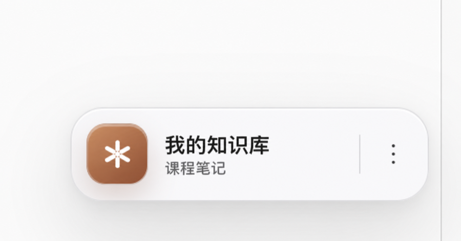
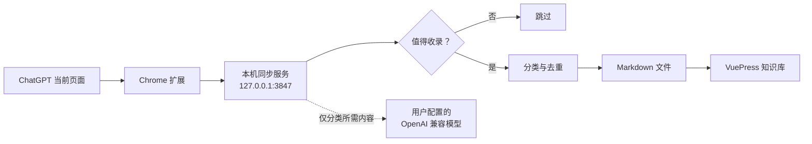

# ChatGPT · VuePress 知识库助手

把 ChatGPT 页面中真正值得保留的问答，整理成一题一页、可搜索、可继续编辑的本地 VuePress 知识库。

它由三部分组成：

- Chrome 扩展：读取当前页面已经显示的问答，并提供同步、分类与多知识库切换界面。
- 本地同步服务：仅监听 `127.0.0.1:3847`，负责筛选、分类、去重和写入 Markdown。
- VuePress 模板：使用 VuePress Theme Hope 展示生成的知识卡片。

<p align="center">
  
</p>

> [!IMPORTANT]
> 仓库不会包含维护者的个人笔记。`src/interview/chatgpt/` 中由同步服务生成的文章默认被 Git 忽略。

## 功能

- 一题一页：不把整段对话塞进一篇长文。
- 智能收录：过滤提示词、格式约束、寒暄和页面操作指令。
- 自动分类：优先查看并复用现有分类，确实没有合适分类时才新建。
- 重复题处理：检测到相同问题时，由用户选择保留已有答案或本次答案。
- 同步范围：可选择“只同步最后一题”或“同步当前对话全部新题”。
- 多知识库：为课程笔记、项目文档、面试复习等分别保存目录、名称、模型和分类偏好。
- 本地优先：文章以普通 Markdown 保存，可自行编辑、Git 管理或部署。
- OpenAI 兼容：API 地址、模型、Key 和 Chat Completions 路径均可配置。

## 工作方式



## 快速开始

### 1. 准备环境

- Node.js 22 或更高版本
- pnpm 10
- Chrome、Edge 或其他支持 Manifest V3 扩展的 Chromium 浏览器

```bash
git clone https://github.com/wanghao512/chatgpt-vuepress-knowledge-base.git
cd chatgpt-vuepress-knowledge-base
pnpm install
```

### 2. 加载浏览器扩展

1. 打开 `chrome://extensions/`。
2. 开启“开发者模式”。
3. 点击“加载已解压的扩展程序”。
4. 选择克隆目录中的 `browser-extension` 文件夹。
5. 刷新已经打开的 ChatGPT 页面。

### 3. 启动知识库

```bash
pnpm dev:sync
```

启动后：

- VuePress：<http://localhost:8080/>
- 同步服务健康检查：<http://127.0.0.1:3847/health>

在 ChatGPT 完成一轮问答后，点击页面右侧的知识库按钮即可同步。

## 配置模型

推荐在扩展的独立“API 设置”页配置，Key 会保存在本机的 `.chatgpt-sync/` 中。也可以复制环境变量示例：

```bash
cp .env.example .env.local
```

通用变量如下：

```dotenv
LLM_BASE_URL=https://api.openai.com
LLM_CHAT_COMPLETIONS_PATH=/v1/chat/completions
LLM_MODEL=gpt-4.1-mini
LLM_API_KEY=
LLM_CLASSIFIER_ENABLED=true
```

请以你账号中实际可用的模型名称为准。不要把 `.env.local`、API Key 或 `.chatgpt-sync/` 提交到 Git。

## 多知识库

设置页可以保存多个知识库档案。每个档案拥有独立的：

- VuePress 项目目录与预览地址
- 知识库名称
- 模型 API 配置
- 自动分类或固定分类偏好

切换档案不会删除任何文章。移除档案也只删除助手中的配置记录。

## 隐私边界

扩展只处理当前 ChatGPT 页面已经显示的问答，不读取 Cookie、密码或账号凭据。内容先发送到本机同步服务；启用智能筛选、分类或语义去重时，分类所需的题目和答案片段会发送到你配置的模型服务商。

生成的 Markdown 会进入 VuePress 构建结果。公开部署前，请自行检查个人信息、内部资料、公司信息和原始对话链接。完整说明见 [PRIVACY.md](./PRIVACY.md)。

## 跨平台

同步服务使用 Node.js，支持 macOS、Windows 和 Linux。CI 会在三个平台上执行测试和 VuePress 构建。浏览器扩展面向支持 Manifest V3 的 Chromium 浏览器。

| 能力 | macOS | Windows | Linux |
| --- | :---: | :---: | :---: |
| 本地同步服务 | ✓ | ✓ | ✓ |
| VuePress 构建 | ✓ | ✓ | ✓ |
| Chromium 扩展 | ✓ | ✓ | ✓ |

## 开发

```bash
pnpm test:sync
pnpm docs:build
```

更多使用说明见 [CHATGPT_SYNC_GUIDE.md](./CHATGPT_SYNC_GUIDE.md) 和 [browser-extension/README.md](./browser-extension/README.md)。参与贡献前请阅读 [CONTRIBUTING.md](./CONTRIBUTING.md)。

## 安全与许可证

- 安全问题请按 [SECURITY.md](./SECURITY.md) 私下报告。
- 项目采用 [MIT License](./LICENSE)。
- VuePress Theme Hope 及其他依赖分别遵循其自身许可证。
