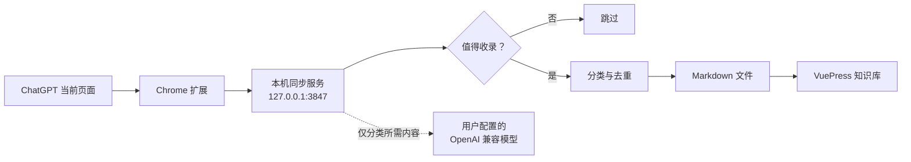

# ChatGPT · VuePress 知识库助手

把 ChatGPT 页面中真正值得保留的问答，整理成一题一页、可搜索、可继续编辑的本地 VuePress 知识库。

它由三部分组成：

- Chrome 扩展：读取当前页面已经显示的问答，并提供同步、分类与多知识库切换界面。
- 本地同步服务：仅监听 `127.0.0.1:3847`，负责筛选、分类、去重和写入 Markdown。
- VuePress 模板：使用 VuePress Theme Hope 展示生成的知识卡片。

<p align="center">
  
</p>

## 当前已实现的功能

下面列出的都是当前版本已经存在的入口和行为，不是路线图。

| 功能 | 在哪里使用 | 实际行为 |
| --- | --- | --- |
| 一题一页 | ChatGPT 页面右侧浮动按钮 | 把一轮完整问答写成独立 Markdown，而不是把整段长对话塞进同一篇文章 |
| 两种同步范围 | 浮动面板 → 同步范围 | 可只同步最后一组完整问答，也可扫描当前对话并补齐全部新题 |
| 完整性核验 | 浮动面板 → 再次检查 | 只读检查最后一道题是否存在、答案是否为当前版本；异常时提示重新同步，不会重复写入 |
| 智能收录 | 本地同步服务 | 跳过寒暄、单纯格式约束、后续回答规则等不适合作为知识条目的内容 |
| 智能或固定归档 | 浮动面板 → 后续问题归档 | 智能模式先读取现有分类再选择；固定模式让后续问题始终进入指定分类 |
| 分类管理 | 浮动面板 → 新建分类 / 重命名 | 新建后立即可选；重命名保留已有目录和文章 URL |
| 归档内去重 | 同步时自动执行 | 只在本次目标归档中检查相同或语义重复题，避免其他学科的同名问题误冲突 |
| 答案冲突选择 | 重复题弹窗 | 同题但答案不同的时候，并排展示已有答案和本次答案，由用户决定保留哪一个 |
| 批量问答入库 | 浮动面板 → 批量问答入库 | 可预设回答规则并粘贴问题素材；模型负责拆题、排序和去重，随后等待每题回答并同步成功后再发送下一题 |
| 无模型回退 | 批量问答入库 | 没有可用模型时按“一行一题”解析，不会阻断普通手动同步 |
| 多知识库档案 | API 设置页顶部 | 为不同项目分别保存 VuePress 目录、知识库名称、预览地址、模型和分类偏好，并可一键切换 |
| 模型与用量设置 | API 设置页 | 管理 OpenAI 兼容地址、模型、Key、Chat Completions 路径，支持连通性测试和本地 Token 统计 |
| 本地 Markdown | VuePress 项目目录 | 结果是可编辑、可搜索、可 Git 管理的普通 Markdown；本地服务只监听 `127.0.0.1` |
| 书籍阅读主题 | VuePress 站点 | 提供统一的纸张质感、暖色阅读界面以及匹配的深色模式 |

## 一个真实使用案例

假设你正在整理一组 Transformer 面试题：

1. 在“后续问题归档”中选择固定分类 `Transformer 高频面试题`。
2. 在 ChatGPT 提问“为什么 Attention 分数要除以 √dₖ？”并等待回答结束。
3. 点击“只同步最后一题”。知识库会生成一个独立页面，保留公式、代码块、表格和回答层级。
4. 之后再次询问同一道题：同步服务只在 `Transformer 高频面试题` 中查重；如果新旧答案不同，扩展会让你选择保留已有答案或改用本次答案。
5. 点击“再次检查”，可以确认最后一道题是否存在且答案为当前最新版本。

需要连续整理整份提纲时，可以在“批量问答入库”中粘贴：

```text
Transformer 的训练和推理有什么区别？
Self-Attention 的计算步骤有哪些？
为什么 Attention 分数需要缩放？
```

再设置回答规则，例如“先模拟面试追问，再给简洁回答和详细解析”。配置了模型时，助手会先整理、去重问题，然后逐题发送；只有当前题回答完成并成功入库后，才会继续下一题。最终侧边栏中每一道题都是可独立打开、搜索和复习的页面。

## 工作方式



## 快速开始

### 1. 准备环境

- Node.js 22 或更高版本
- pnpm 10
- Chrome、Edge 或其他支持 Manifest V3 扩展的 Chromium 浏览器

```bash
git clone https://github.com/wanghao512/chatgpt-vuepress-knowledge-base.git
cd chatgpt-vuepress-knowledge-base
pnpm install
```

### 2. 加载浏览器扩展

1. 打开 `chrome://extensions/`。
2. 开启“开发者模式”。
3. 点击“加载已解压的扩展程序”。
4. 选择克隆目录中的 `browser-extension` 文件夹。
5. 刷新已经打开的 ChatGPT 页面。

### 3. 启动知识库

```bash
pnpm dev:sync
```

启动后：

- VuePress：<http://localhost:8080/>
- 同步服务健康检查：<http://127.0.0.1:3847/health>

在 ChatGPT 完成一轮问答后，点击页面右侧的知识库按钮即可同步。

## 配置模型

推荐在扩展的独立“API 设置”页配置，Key 会保存在本机的 `.chatgpt-sync/` 中。也可以复制环境变量示例：

```bash
cp .env.example .env.local
```

通用变量如下：

```dotenv
LLM_BASE_URL=https://api.openai.com
LLM_CHAT_COMPLETIONS_PATH=/v1/chat/completions
LLM_MODEL=gpt-4.1-mini
LLM_API_KEY=
LLM_CLASSIFIER_ENABLED=true
```

请以你账号中实际可用的模型名称为准。不要把 `.env.local`、API Key 或 `.chatgpt-sync/` 提交到 Git。

模型是增强项而不是基础同步的前置条件：

- 配置模型后，可使用智能筛选、智能分类、语义去重和批量问题整理。
- 未配置模型时，仍可手动同步、使用固定分类、按精确题目去重，并按一行一题启动批量任务。
- 未配置模型时会采用对应的本地保底逻辑；已配置但调用失败时会明确报错并暂停相关智能任务，不会静默生成错误结果。
- API Key 不会写入生成的 Markdown。

## 多知识库

设置页可以保存多个知识库档案。每个档案拥有独立的：

- VuePress 项目目录与预览地址
- 知识库名称
- 模型 API 配置
- 自动分类或固定分类偏好

切换档案不会删除任何文章。移除档案也只删除助手中的配置记录。

## 隐私边界

扩展只处理当前 ChatGPT 页面已经显示的问答，不读取 Cookie、密码或账号凭据。内容先发送到本机同步服务；启用智能筛选、分类或语义去重时，分类所需的题目和答案片段会发送到你配置的模型服务商。

生成的 Markdown 会进入 VuePress 构建结果。公开部署前，请自行检查个人信息、内部资料、公司信息和原始对话链接。完整说明见 [PRIVACY.md](./PRIVACY.md)。

## 跨平台

同步服务使用 Node.js，支持 macOS、Windows 和 Linux。CI 会在三个平台上执行测试和 VuePress 构建。浏览器扩展面向支持 Manifest V3 的 Chromium 浏览器。

| 能力 | macOS | Windows | Linux |
| --- | :---: | :---: | :---: |
| 本地同步服务 | ✓ | ✓ | ✓ |
| VuePress 构建 | ✓ | ✓ | ✓ |
| Chromium 扩展 | ✓ | ✓ | ✓ |

## 当前限制

- 扩展目前面向 Chrome、Edge 等 Chromium 浏览器，尚未打包为 Firefox 或 Safari 扩展。
- 本地同步依赖正在运行的 Node.js 服务；关闭终端后，扩展仍会显示，但不能写入 VuePress。
- ChatGPT 页面结构发生较大调整时，页面内容提取可能需要随版本更新。
- “批量问答入库”发送的是普通用户消息，无法向 ChatGPT 网页注入真正的 `system` 角色消息；建议在新对话中运行。
- 本地 Token 统计来自模型接口返回的 usage 字段，仅用于参考，不等同于服务商账单。

## 开发

```bash
pnpm test:sync
pnpm docs:build
```

更多使用说明见 [CHATGPT_SYNC_GUIDE.md](./CHATGPT_SYNC_GUIDE.md) 和 [browser-extension/README.md](./browser-extension/README.md)。参与贡献前请阅读 [CONTRIBUTING.md](./CONTRIBUTING.md)。

## 安全与许可证

- 安全问题请按 [SECURITY.md](./SECURITY.md) 私下报告。
- 项目采用 [MIT License](./LICENSE)。
- VuePress Theme Hope 及其他依赖分别遵循其自身许可证。
